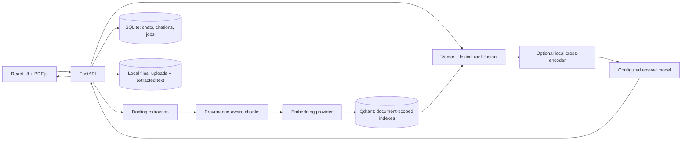

<div align="center">

# Cognora

**A private, local-first workspace for asking questions about your documents.**

[](https://github.com/AkshayKumarBolusani/cognora-ai/actions/workflows/ci.yml)
[](LICENSE)

Upload a document, ask questions grounded in its contents, and follow citations back to the source.

</div>

> Cognora is under active development. Treat generated answers as a starting point and verify them against the cited document.

## See it in action

We are preparing a privacy-safe walkthrough with the public TCS sample report. No demo GIF is included yet; personal documents and screenshots are never used as repository assets.

## Results

There is no published model accuracy score yet. The repository now includes a reproducible 30-question set across prose, financial tables, and charts, with expected answers and citation pages. Run the [evaluation](eval/README.md) to produce answer-match and citation-page scores. Scores are not included until they have been measured against a named model configuration.

| Set | Questions | Answer accuracy | Citation page accuracy |
| --- | ---: | ---: | ---: |
| TCS FY2025-26 report | 30 (10 prose, 10 tables, 10 charts) | Not measured | Not measured |

## What Cognora does

- Chats with PDF, office, text, Markdown, web, ebook, and image documents through a local UI.
- Keeps document indexes isolated and optionally compares up to ten selected documents.
- Combines vector similarity and lexical retrieval using reciprocal-rank fusion; an optional local cross-encoder can rerank the candidates.
- Preserves page and element provenance, supports exact PDF text highlighting where the PDF has selectable text, and shows retrieved PDF figure images in chat.
- Extracts table structure and embeds table text with column context while retaining original text for answers.
- Stores chats, citations, processing jobs, uploads, and indexes locally; supports retry and permanent deletion.
- Uses Ollama by default, with OpenAI and Gemini adapters for supported answer, embedding, and vision tasks.

## Architecture



The UI calls the FastAPI service. Docling extracts text, tables, figures, and available page provenance. Cognora embeds extracted chunks into a Qdrant collection scoped to each uploaded document and embedding configuration. At question time, vector and lexical rankings are fused; if configured, a local cross-encoder reranks a larger candidate pool. The answer model receives the original extracted evidence. Conversation state and citations live in SQLite. See [architecture and data flow](docs/ARCHITECTURE.md).

## Quick start

Requirements: Python 3.11 or 3.12, Node.js 22, and an embedding and answer provider. Python 3.11 and 3.12 are the CI-supported versions. The checked-in public TCS report is optional sample content.

```bash
python3 -m venv .venv
source .venv/bin/activate
python -m pip install --upgrade pip
python -m pip install -r requirements-lock.txt
cp .env.example .env
```

For the default local provider, install [Ollama](https://ollama.com/) and pull the models named in `.env.example`:

```bash
ollama pull nomic-embed-text
ollama pull qwen2.5vl:7b
```

Start the API from the repository root:

```bash
.venv/bin/python -m uvicorn src.ui.api:app --reload --host 127.0.0.1 --port 8000
```

In another terminal:

```bash
cd frontend
npm ci
npm run dev
```

Open the local Vite URL (normally `http://localhost:5173`). See [configuration](docs/CONFIGURATION.md) for model, CORS, and reranker settings or [Docker Compose](docker-compose.yml) to run the services in containers.

## Supported files and known limits

The upload endpoint currently accepts PDF, DOC/DOCX/RTF, PPT/PPTX, XLS/XLSX/CSV, TXT/Markdown, HTML/MHTML, ODT/ODS/ODP, EPUB, and PNG/JPEG/TIFF/BMP/WebP files, up to 200 MB. Extension acceptance does not guarantee successful extraction; scanned pages, unusual layouts, and unsupported features can reduce quality. Text and Markdown are read as UTF-8. See [processing details and limits](docs/ARCHITECTURE.md#document-processing).

- Page numbers depend on the parser and file format; plain text and Markdown do not have pages.
- Exact highlighting requires selectable PDF text and a source-text match. Cognora does not show an excerpt as a substitute when the highlight cannot be made.
- Inline figure evidence currently covers extracted PDF figures; figure descriptions require a configured vision provider.
- A deterministic query route handles minimum/maximum amount questions over Markdown transaction tables. Other aggregation and complex filtered-table questions use normal retrieval and can be less reliable.
- The cross-encoder reranker is optional, runs locally, and downloads its configured model on first use. It is off by default. No reranker benchmark is published yet.
- The API has no authentication and is intended for local/private use. Do not expose it directly to the public internet.

## Development

```bash
.venv/bin/python -m unittest discover -s tests -v
.venv/bin/python -m py_compile src/ui/api.py src/ui/providers.py src/ui/retrieval.py
cd frontend && npm run build
```

CI runs the backend suite on Python 3.11 and 3.12 and builds the frontend. Report bugs without attaching private document content or credentials. See the [roadmap](ROADMAP.md), [API reference](docs/API.md), [configuration reference](docs/CONFIGURATION.md), and [security notes](docs/SECURITY.md).

## License

MIT. See [LICENSE](LICENSE).
