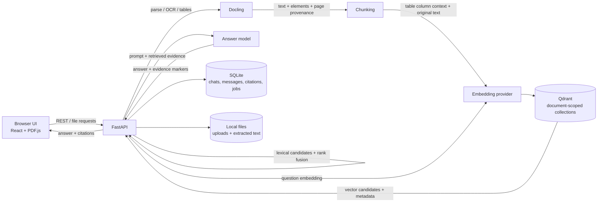

<div align="center">

# Cognora

**A private, local-first workspace for asking questions about your documents.**

[](https://github.com/AkshayKumarBolusani/cognora-ai/actions/workflows/ci.yml)
[](LICENSE)

Upload a file, get grounded answers with source citations, and keep your conversations and indexes on your machine.

</div>

> Cognora is under active development. See [Known limits](#known-limits) before relying on it for important decisions.

## Results

There is no published end-to-end accuracy score yet. The local workspace has ten visually verified financial table facts from two report pages. That is a useful regression fixture, but not a balanced evaluation set and cannot support a credible text/table/chart accuracy claim. Scores will be reported only after a reproducible labeled set and citation checks are run across all three question types. See [Evaluation](#evaluation).

## Contents

- [Features](#features)
- [Architecture](#architecture)
- [Quick start](#quick-start)
- [Configuration](#configuration)
- [Supported uploads](#supported-uploads)
- [How document chat works](#how-document-chat-works)
- [Deleting content](#deleting-content)
- [Data locations and privacy](#data-locations-and-privacy)
- [Development and checks](#development-and-checks)
- [Known limits](#known-limits)
- [Contributing](#contributing)
- [Support](#support)
- [License](#license)

## Features

- Chat with uploaded documents using retrieval-augmented generation (RAG).
- Keep each document's vectors isolated and optionally compare up to ten selected, processed documents in one chat turn.
- Combine vector similarity with lexical matching and reciprocal-rank fusion to improve exact names, dates, and numeric retrieval.
- Embed tables with their column names while retaining the original table text as answer evidence.
- Preserve extracted element type, source element ID, and page number where the parser provides them.
- Store conversations and citations in SQLite.
- Preview PDFs in a continuous viewer, view supported images directly (TIFF is converted for browser display), and read text or extracted content for other supported formats.
- Navigate PDF citations to exact matched text when the source has a selectable text layer.
- Process plain text and Markdown directly; use Docling for supported office, web, ebook, and image formats.
- Save extracted PDF figures and display retrieved figure evidence inline with chat answers; figure descriptions can be enriched with a separately configured vision model.
- Retry document processing, see persistent job status, and prevent chat until indexing succeeds.
- Delete a chat and its messages, or permanently delete a document together with its chats, uploaded file, extracted text, processing history, and document-scoped vector indexes.
- Run the API and UI locally with Ollama, or configure cloud model providers.

## Technology

- Frontend: React 19, TypeScript, Vite, react-pdf and PDF.js.
- API: Python, FastAPI, Uvicorn.
- Extraction: Docling, with direct UTF-8 text handling for .txt and .md.
- Retrieval: Qdrant local storage and provider-generated embeddings.
- Persistence: SQLite for conversations, messages, citations, and processing jobs; a JSON registry for uploaded-document metadata.
- Model adapters: Ollama, OpenAI-compatible APIs, and Gemini for their supported answer, embedding, or vision tasks.

## Architecture

The browser talks to the FastAPI service. The API coordinates extraction, embeddings, retrieval, model responses, and persistence. Each uploaded document has an isolated vector collection; conversation history and citations are stored separately in SQLite. Retrieval fuses vector-ranked and exact-token-ranked candidates, then passes the original extracted text to the answer model.



### Repository layout

```text
cognora/
├── frontend/                 # React application and PDF preview
│   ├── src/App.tsx           # Chat, document list, upload, deletion flows
│   └── src/DocumentPreview.tsx
├── src/ui/
│   ├── api.py                # FastAPI routes and processing jobs
│   ├── providers.py          # Answer and vision model adapters
│   └── retrieval.py          # Chunking, embeddings, Qdrant, retrieval
├── tests/                    # API workflow and retrieval tests
├── data/                     # Local user data; ignored by Git
├── requirements-lock.txt
└── README.md
```

## Requirements

- Python 3.14 with venv support. The checked-in lockfile and local environment use Python 3.14.7; Docling declares Python `>=3.10,<4.0`. Other platform and Python combinations are not currently verified.
- Node.js and npm compatible with the Vite version in frontend/package-lock.json.
- An embedding provider and an answer-generation provider. For the default local setup, install Ollama and pull the configured models.
- Disk space for Docling models, uploaded files, extracted text, and local Qdrant indexes.

## Quick start

Run commands from the repository root unless the command says otherwise.

### 1. Install the backend

    python3 -m venv .venv
    source .venv/bin/activate
    python -m pip install --upgrade pip
    python -m pip install -r requirements-lock.txt

### 2. Configure models

    cp .env.example .env

The default configuration uses Ollama. Pull the default models before processing documents:

    ollama pull nomic-embed-text
    ollama pull qwen2.5vl:7b

nomic-embed-text creates vectors. qwen2.5vl:7b generates answers and can describe figures if vision is enabled. Answer, embedding, and vision providers are configured independently in .env. Keep API keys server-side; never put them in VITE_ variables or commit .env.

### 3. Start the API

    .venv/bin/python -m uvicorn src.ui.api:app --reload --host 127.0.0.1 --port 8000

The API is available at http://127.0.0.1:8000; interactive OpenAPI docs are at http://127.0.0.1:8000/docs.

### 4. Start the frontend

In another terminal:

    cd frontend
    npm install
    npm run dev

Open the local URL printed by Vite (normally http://localhost:5173).

## Configuration

Copy .env.example to .env. The API loads it from the repository root.

| Variable | Purpose |
| --- | --- |
| LLM_PROVIDER | Answer provider: ollama, openai, or gemini. |
| LLM_MODEL | Answer-generation model name. |
| LLM_API_KEY | Server-side API key for OpenAI or Gemini. Leave empty for Ollama. |
| LLM_BASE_URL | Optional provider endpoint. |
| EMBEDDING_PROVIDER | Vector provider: ollama, openai, or gemini. |
| EMBEDDING_MODEL | Embedding model. It must support embeddings. |
| EMBEDDING_BATCH_SIZE | Embedding texts per request (1–64, default 16). Lower it if the local model runs out of memory. |
| EMBEDDING_API_KEY | Server-side embedding API key for OpenAI or Gemini. |
| EMBEDDING_BASE_URL | Optional embedding endpoint. |
| VISION_PROVIDER | Optional figure-description provider: ollama, openai, or gemini. Empty disables figure descriptions. |
| VISION_MODEL | Vision model name. |
| VISION_API_KEY | Server-side vision API key for OpenAI or Gemini. |
| VISION_BASE_URL | Optional vision endpoint. |
| RETRIEVAL_TOP_K | Maximum number of retrieved passages (clamped to 1–20). |
| RETRIEVAL_SCORE_THRESHOLD | Minimum vector similarity score (clamped to 0–1). |
| CORS_ORIGINS | Comma-separated extra frontend origins for the API. |
| VITE_API_BASE_URL | Frontend API URL at build/dev time; defaults to http://localhost:8000/api. This is not a place for secrets. |

For OpenAI-compatible services, set the corresponding provider and model and supply the service's base URL and key. Ollama defaults to http://localhost:11434. A changed embedding provider or model uses a separate index namespace; process documents again to create indexes for that configuration.

Docling's initialized parser stays warm while the API is running, reducing startup work for later documents. Embedding requests use bounded batches of 16 by default to reduce request overhead; set `EMBEDDING_BATCH_SIZE` lower if your machine is memory constrained. The first document still pays the parser/model initialization cost.

## Supported uploads

The upload endpoint accepts these extensions:

.pdf, .docx, .doc, .rtf, .pptx, .ppt, .xlsx, .xls, .csv, .txt, .md, .html, .htm, .mhtml, .odt, .ods, .odp, .epub, .png, .jpg, .jpeg, .tif, .tiff, .bmp, and .webp.

Uploads are limited to 200 MB. .txt and .md are read as UTF-8 text and indexed directly. Other formats are passed to Docling; actual extraction depends on the source file's contents and Docling's support for that format. An accepted extension means the upload is allowed, not that every file will yield readable text. Processing reports an error if extraction or indexing fails.

## How document chat works

1. The API stores the source file and adds it to the document registry.
2. Processing extracts text and structured elements. Page and element provenance is retained when available; table text and figure captions are included. Extracted PDF figures are stored locally and can be shown beside answers that retrieve them. Use **Refresh document analysis** after upgrading an existing index to extract and link its figures.
3. Extracted content is divided into chunks. Embeddings are requested in bounded batches and stored in a collection scoped to the document, content, and embedding configuration.
4. A question is embedded and searched only against the selected document's collection. Exact-token candidates are ranked alongside vector candidates and combined with reciprocal-rank fusion.
5. Retrieved passages are sent to the configured answer model. Table column names help retrieval, while original extracted table text remains the evidence. Citations are persisted with the assistant message and can navigate the PDF preview; retrieved PDF figure citations also show their extracted image inline in chat.

For highest/lowest questions on extracted Markdown transaction tables, Cognora scans every matching row and the requested month directly instead of asking semantic top-k retrieval to estimate an extremum. It returns the selected table row with its source page when available.

The app blocks chat when a document has not been successfully extracted and indexed. If no evidence clears the configured retrieval threshold, Cognora reports that it could not find relevant evidence. Answers still need to be checked against the source.

## Evaluation

Evaluation is intentionally not represented by made-up scores. The local workspace has ten visually verified gold table facts from two report pages; they are not checked into Git and do not cover prose, charts, varied question phrasing, or end-to-end model answers. The report PDF is not included in Git. A useful benchmark needs 30–50 independently labeled questions split across prose, tables, and charts, each with an expected answer, page, and evidence span. Report answer accuracy and citation page/span correctness separately, and record model/provider versions, retrieval settings, and the commit tested. Do not compare retrieval changes using different question sets or model settings.

Cross-document comparison can be enabled from **Compare across documents** above the composer. It searches only the checked, processed documents (up to ten) and interleaves evidence from each selected collection. The active chat's document is always included. Compare-mode answers still depend on extraction quality and should be checked against each cited file.

## Deleting content

- Use the trash button beside a chat to permanently delete that conversation and its messages.
- Use the trash button beside a document to permanently delete the document registry entry, uploaded file, extracted text, processing-job records, all its chats and messages, and vector collections whose names are scoped to that document.
- Document deletion is blocked while processing is queued or running. Wait for that job to finish, then retry.
- Deletion does not remove unrelated documents or the standalone tcs_annual_report_v1 collection.

These actions are permanent. The confirmation dialog names the document or chat before deletion.

## Data locations and privacy

Local application data is stored under data/:

- data/uploads/ — uploaded originals.
- data/processed/user_documents/ — extracted Markdown text.
- data/vector_db/ — local Qdrant indexes.
- data/documents.json — document registry.
- data/app.db — conversations, messages, citations, and processing jobs.

These paths, local model/cache files, .env, and frontend build artifacts are ignored by Git. Do not commit private documents, generated indexes, or credentials. With Ollama, model requests go to the configured local Ollama server. With a cloud provider, extracted passages or questions are sent to that provider for embedding or answer generation.

## API overview

The interactive API reference at /docs is the source of truth. Main routes include:

| Method | Route | Description |
| --- | --- | --- |
| GET | /api/health | API health. |
| GET | /api/documents | List documents and effective processing readiness. |
| POST | /api/documents | Upload a supported file. |
| GET | /api/documents/{id}/file | Stream the original file. |
| POST | /api/documents/{id}/process | Queue or reuse the active processing job. |
| GET | /api/processing-jobs/{id} | Read persistent job progress. |
| DELETE | /api/documents/{id} | Permanently delete a document and its associated data. |
| GET | /api/documents/{id}/chats | List a document's conversations. |
| POST | /api/chats | Create a conversation. |
| GET | /api/chats/{id}/messages | Read messages and citations. |
| POST | /api/chats/{id}/messages | Ask a question using document retrieval. |
| DELETE | /api/chats/{id} | Permanently delete a conversation and its messages. |

## Development and checks

Backend tests use the Python standard library's unittest runner:

    .venv/bin/python -m unittest discover -s tests -v
    .venv/bin/python -m py_compile src/ui/api.py src/ui/providers.py src/ui/retrieval.py

Frontend checks:

    cd frontend
    npm run build
    npm run lint

CI runs the backend unit suite and frontend production build on pushes and pull requests. Docker Compose builds the API and web UI; configure `.env` first and start with:

    docker compose up --build

Then open http://localhost:5173. The Compose setup persists `./data`; model services still need to be available at the URLs configured in `.env` (for Ollama running on the host, use a host-reachable URL from inside Docker).

The linter may report warnings in bundled PDF.js assets. The production build may also report a large JavaScript chunk because PDF.js is included.

## Known limits

- Page numbers depend on the parser and source format; Markdown and other non-paginated files do not have page numbers.
- Exact text highlighting depends on a selectable PDF text layer and an exact source-text match. When it cannot match, Cognora keeps the source/page citation but does not display an excerpt as a substitute.
- Figure descriptions require a configured vision provider and usable figure images. Vision failures do not prevent text indexing.
- Provider configuration is currently environment-based; there is no in-app model settings editor or live provider validation screen.
- OCR and table extraction quality varies with scan quality, layout, language, and file type.
- PDF files use the continuous page viewer. Image files show the image (TIFF previews are converted to PNG without changing the upload). Text and Markdown preview directly; other supported formats show extracted text after processing. These text previews are limited to 10 MB.
- There are no published benchmark scores yet. Figure retrieval and inline image display are supported for extracted PDF figures; coverage for figures in other formats is not guaranteed.

## Contributing

Contributions are welcome. Before opening a pull request:

1. Open an issue to discuss larger changes.
2. Keep changes focused and include or update tests for behavior changes.
3. Run the backend tests and frontend build listed above.
4. Never include real API keys, private documents, local databases, or generated vector indexes.

When reporting a bug, include the operating system, provider/model configuration (with keys removed), file type, and relevant error text. Do not attach private document contents.

## Support

Use the Issues tab of the GitHub repository where you found this README to report a reproducible bug or request a feature. Include steps to reproduce and the expected result. Remove personal data, API keys, and document contents from logs and screenshots.

## License

This project is licensed under the [MIT License](LICENSE).
