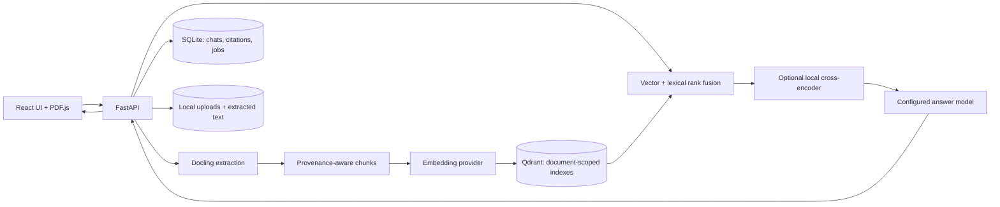

# Architecture and data flow

The browser UI is a React/TypeScript application served by Vite. It calls a FastAPI service that owns document processing, retrieval, provider calls, and persistence.

Each uploaded document gets an isolated Qdrant collection scoped by its ID, content hash, and embedding configuration. Multi-document compare mode searches only selected, processed collections and merges their evidence. Retrieval combines vector and BM25-style lexical candidate rankings using reciprocal-rank fusion. If `RERANKER_MODEL` is set, Transformers scores the fused candidate pool locally and reorders it before the answer model receives the original extracted evidence.

Conversations, messages, citations, and processing jobs are stored in SQLite. Uploaded-document metadata is kept in a JSON registry. Original uploads, extracted Markdown, and local Qdrant data remain under `data/`.

## Document processing

1. The API accepts a supported extension, strips submitted path components, assigns a UUID, and caps upload reads at 200 MB.
2. The API queues a persistent processing job. Docling parses office, PDF, image, web, and ebook formats; plain text and Markdown are decoded directly as UTF-8.
3. Extracted blocks retain parser-provided type, page, and element ID. Tables are embedded with column context, but original extracted table text is retained as answer evidence. Extracted PDF figures can be described by the optional vision provider and shown inline when cited.
4. The API chunks content and indexes it in a document-scoped Qdrant collection. Chat remains unavailable until indexing succeeds.

Parser support varies by format and source quality. Page numbers are unavailable for unpaginated text formats. Exact text highlighting needs a selectable PDF text layer and a direct source match. Figure extraction currently targets PDFs.

## Question routing

One deterministic route scans Markdown transaction tables for minimum/maximum amount questions and can filter by month/year, credit/debit, or balance. It returns the full matching source row with its page citation. This covers transaction-table extrema; general arithmetic, arbitrary table filtering, and other aggregates are left to hybrid retrieval and the answer model.

## Legacy report collection

`tcs_annual_report_v1` is a standalone Qdrant collection built by `src/build_index.py` from the public TCS annual report for offline retrieval experiments. It predates uploaded-document IDs, so normal per-document deletion deliberately leaves it alone. It is not an upload owned by a user's document registry.
